# Звіт за груповим завданням 7: веб-інтерфейс на Thymeleaf

Команда: Олійник Діана, Мошенський Олег, Малій Олександра, Забіяка Денис. Хто що зробив, описано в `Work_Report.md` (розділ «Звіт за 7 групове завдання»).

## 1. Що зроблено

До REST API системи керування розумним домом додано веб-інтерфейс для користувачів у браузері:

- сторінка входу та сторінки помилок 403, 404 і 5xx;
- список «Мої пристрої» та форма додавання пристрою (валідація JSR-380, Post-Redirect-Get);
- сторінка пристрою зі списком команд за роллю та формою «Додати команду» лише для власника;
- спільні фрагменти (шапка, підвал), глобальні стилі з версіонуванням за хешем вмісту;
- окремий ланцюг безпеки для сторінок із входом через форму та увімкненим CSRF, а REST лишився на JWT.

## 2. Ланцюги безпеки

Запит потрапляє у перший ланцюг, чий `securityMatcher` йому підходить. REST перенесено під префікс `/api`, щоб відокремити його від сторінок.

| Порядок | Ланцюг | Адреси | Автентифікація | Сесія | CSRF | Відповідь на помилку |
|---|---|---|---|---|---|---|
| 1 | `apiFilterChain` | `/api/**` | JWT у заголовку `Authorization: Bearer` (вхід `POST /api/login`) | немає (`STATELESS`) | вимкнений | JSON `ProblemDetail`, 401 і 403 |
| 2 | `toolsFilterChain` | `/swagger-ui/**`, `/v3/api-docs/**`, `/h2-console/**` | відкрито | не потрібна | вимкнений | н/д |
| 3 | `webFilterChain` | решта (`/login`, `/devices`, статика) | форма входу, поле `email` | `HttpSession` | **увімкнений** | редірект на `/login`, сторінки 403, 404, 5xx |

Деталі ланцюга для сторінок:

- відкриті без входу лише `/login`, `/css/**`, `/js/**` і `/error`, решта для автентифікованих;
- вхід `POST /login` (форма), успіх веде на `/devices`, помилка на `/login?error`;
- вихід лише `POST /logout` (з токеном CSRF), після нього `/login?logout`;
- користувачі й паролі ті самі, що й для REST (`JpaUserDetailsService`, Argon2id), глобальних ролей немає;
- заголовки: `Content-Security-Policy: default-src 'self'; img-src 'self' data:; script-src 'self'; style-src 'self'; frame-ancestors 'none'` і `Referrer-Policy: strict-origin-when-cross-origin`, Spring Security додає також `X-Content-Type-Options`.

Токен не відкриває сторінок, а сесійна кука не відкриває REST: JWT працює лише під `/api`, сесія лише для сторінок.

Фільтри `JwtAuthenticationFilter` і `JwtLoginFilter` створюються через `new` у ланцюгу 1, а не як біни, тож не діють на сторінки.

## 3. Ролі та права

Ролі зберігаються в БД на рівні пристрою (`DeviceAccess`): **OWNER** і **GUEST**. Глобальних ролей (USER/ADMIN) немає, тому кнопки й розділи показуються за роллю на конкретному пристрої, а не через `hasRole`.

| Дія | Анонім | Користувач без доступу до пристрою | GUEST | OWNER |
|---|---|---|---|---|
| Відкрити будь-яку сторінку | редірект на `/login` | так | так | так |
| Список «Мої пристрої» | редірект | порожній стан | лише свої пристрої з роллю GUEST | свої пристрої з роллю OWNER |
| Створити пристрій | редірект | стає власником нового | стає власником нового | стає власником нового |
| Сторінка пристрою `/devices/{id}` | редірект | **404** | команди лише для гостей, без форми | усі команди та форма «Додати команду» |
| `POST /devices/{id}/commands` | редірект | **403** | **403** | команду створено |

Права перевіряються і в інтерфейсі, і на сервері:

- у шаблоні форма команди показується лише за прапорцем `isOwner` у моделі (`th:if="${isOwner}"`), ім'я користувача у шапці через діалект `sec:authentication`;
- прямий POST захищено `@PreAuthorize("@deviceAccessChecker.isOwner(#id, authentication)")`, тому приховування кнопки не є єдиним захистом;
- чужий або неіснуючий пристрій дає 404, щоб не розкривати його існування.

## 4. Сторінки та знімки

Усі знімки лежать у `docs/screenshots/lab7/`. Сторінки використовують лише готові класи з глобального `static/css/app.css`, без власних стилів і скриптів у HTML.

### Анонім

| Сторінка | Знімок |
|---|---|
| Вхід (`/login`, без шапки й підвалу) | 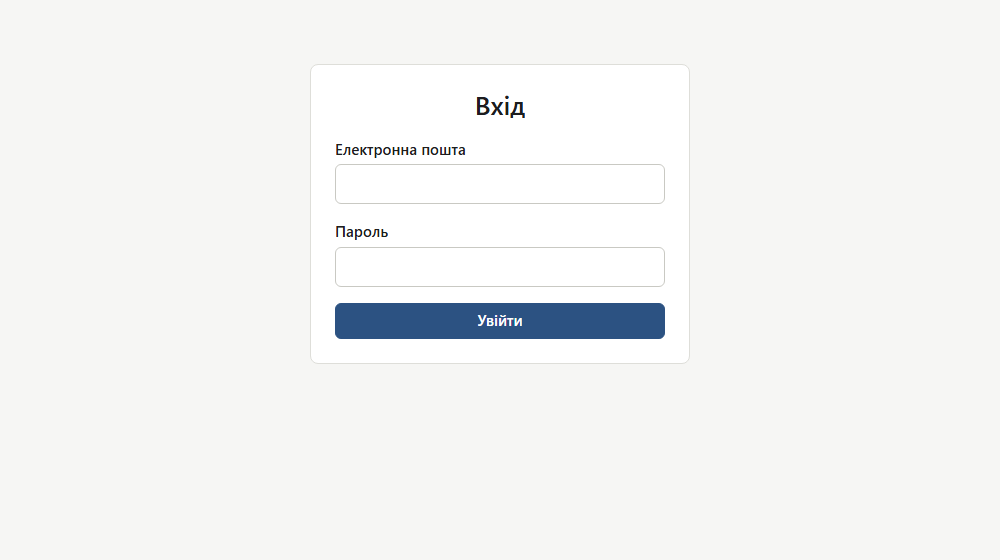 |
| Помилка входу (`/login?error`) | 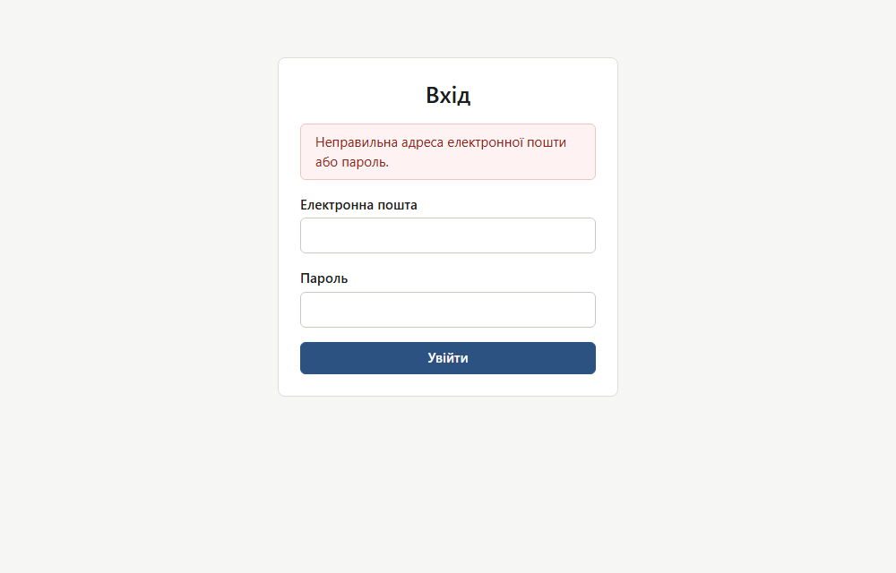 |

### Власник (OWNER)

| Сторінка | Знімок |
|---|---|
| Мої пристрої | 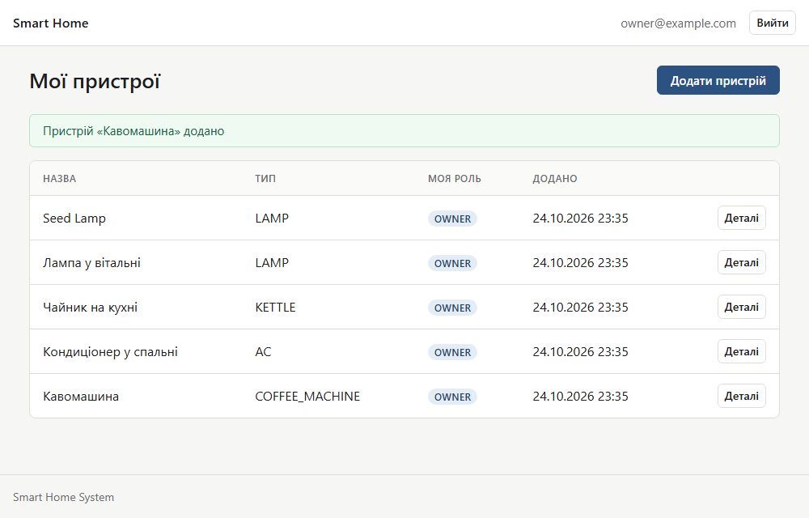 |
| Форма додавання пристрою з помилками валідації | 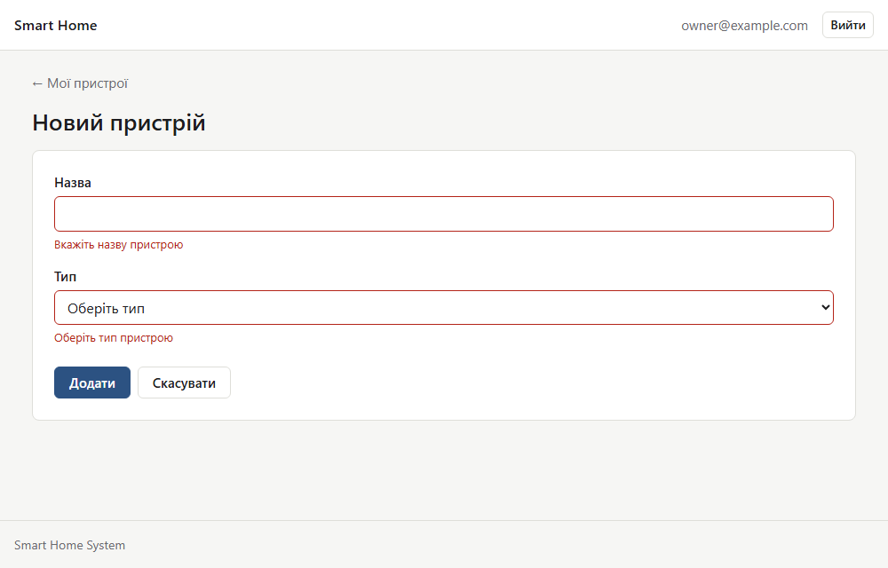 |
| Сторінка пристрою: усі команди та форма «Додати команду» | 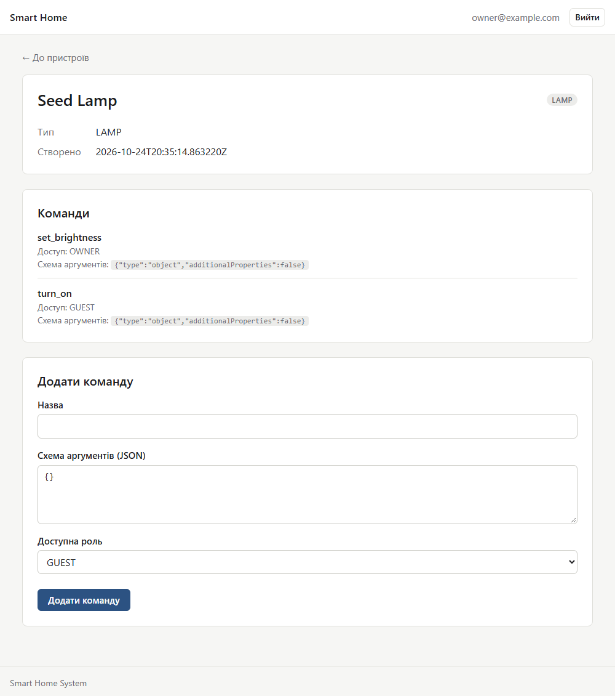 |
| Дублікат назви команди як помилка поля | 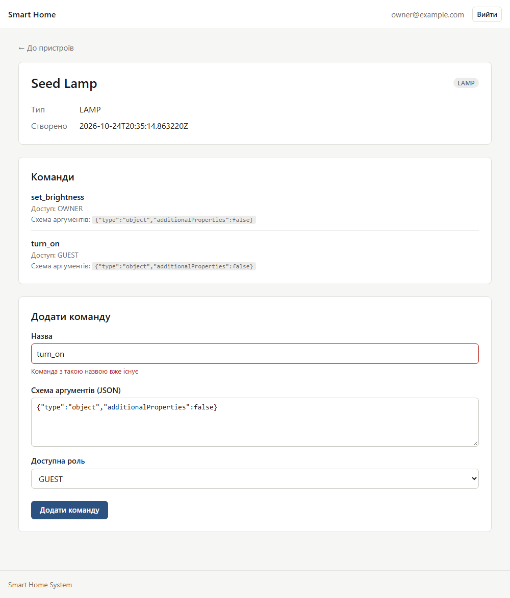 |

### Гість (GUEST)

| Сторінка | Знімок |
|---|---|
| Мої пристрої (пристрій, до якого надано доступ) | 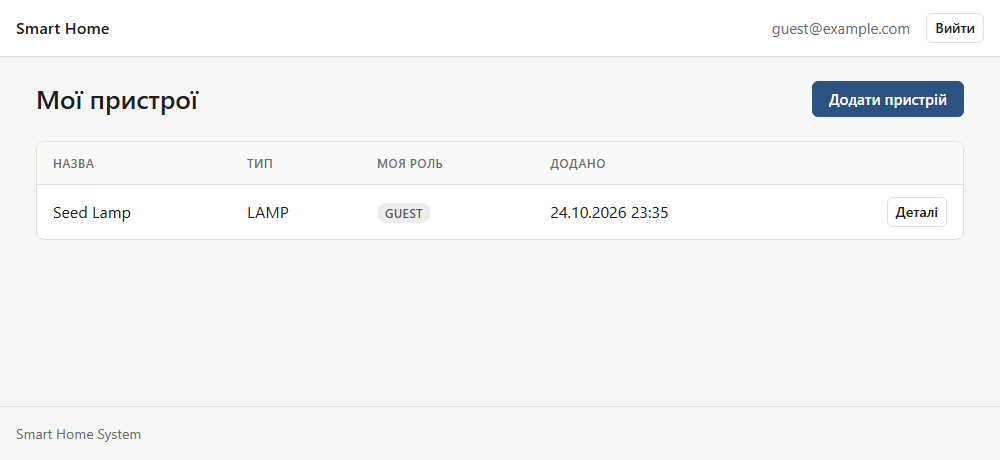 |
| Сторінка пристрою: лише команди для гостей, без форми | 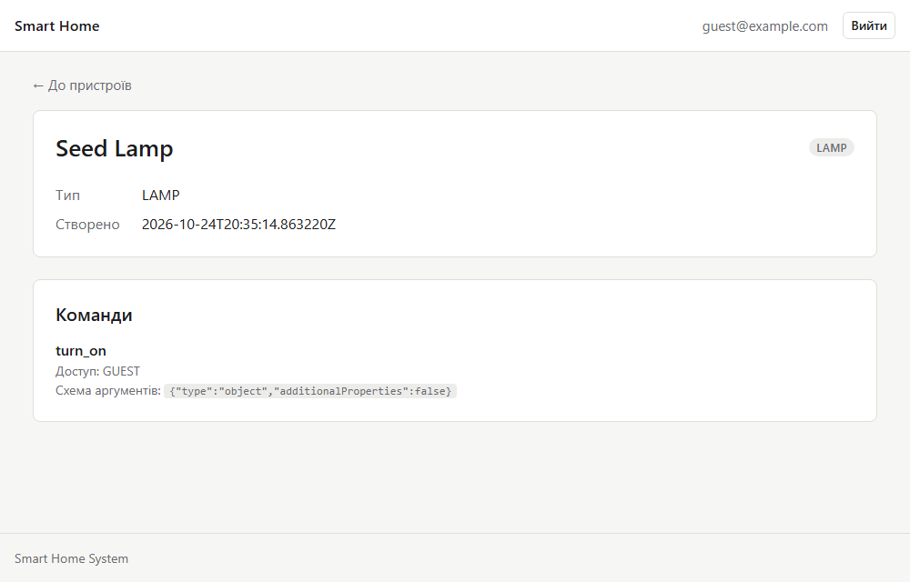 |
| Прямий POST команди від гостя: сторінка 403 | 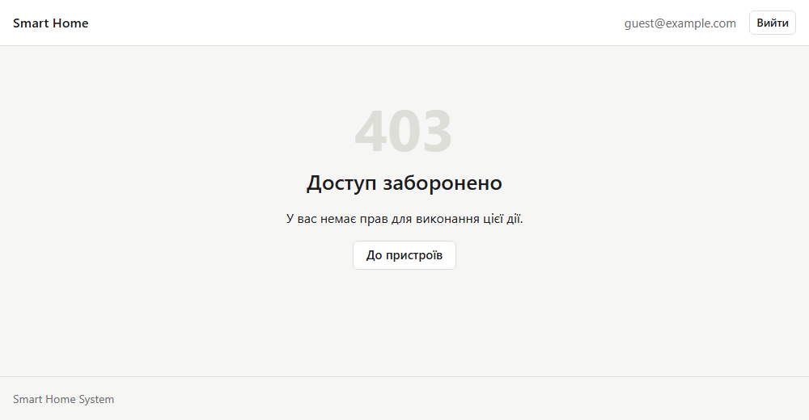 |

### Користувач без доступу та помилки

| Сторінка | Знімок |
|---|---|
| Порожній список для користувача без пристроїв | 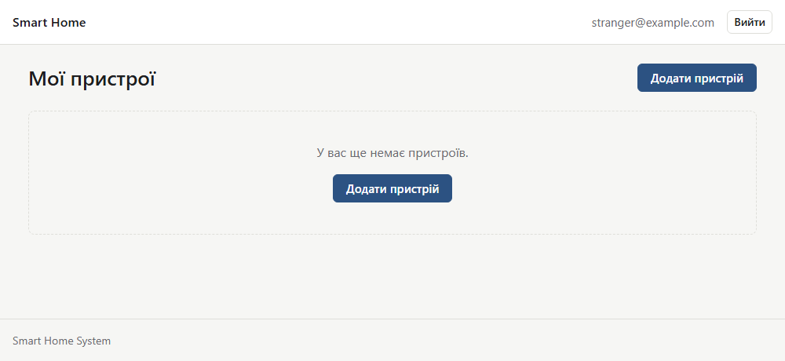 |
| Чужий пристрій: сторінка 404 | 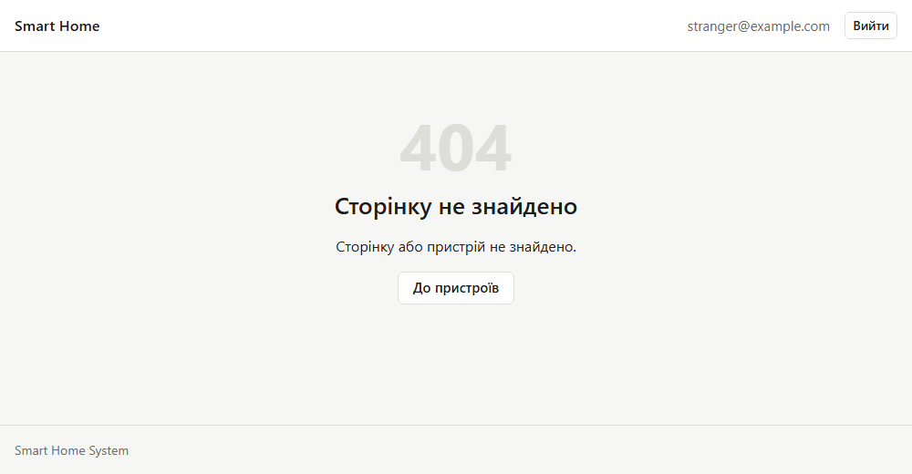 |
| Помилка сервера (5xx) | 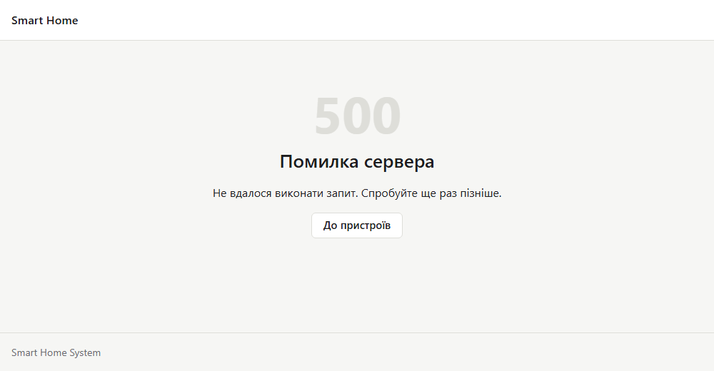 |

## 5. Захист сторінок

| Загроза | Як закрито |
|---|---|
| CSRF | CSRF увімкнений у ланцюгу сторінок; усі форми з `th:action` отримують приховане поле `_csrf`; вихід лише POST; POST без токена дає 403 |
| XSS | усі дані виводяться через `th:text` (екранування), `th:utext` не використовується; тест `scriptInDeviceNameIsEscaped` перевіряє назву ``; CSP забороняє inline-скрипти й стилі |
| Clickjacking | `frame-ancestors 'none'` у CSP |
| SSTI та open redirect | контролери повертають лише константні імена шаблонів і `redirect:` на фіксовані адреси, імена шаблонів не складаються з параметрів запиту |
| Подвійне надсилання форми | Post-Redirect-Get: після успішного створення редірект, повідомлення успіху передається через flash-атрибут і показується один раз |
| Розкриття існування облікових записів | однакове повідомлення про помилку входу для невідомого користувача й неправильного пароля |
| Витік технічних деталей | власні сторінки 403, 404 і 5xx без стеку; токен підключення пристрою ніколи не виводиться в HTML |
| Валідація лише в браузері | перевірка на сервері: `@Valid`, `@NotBlank`, `@NotNull`, `@Size(max = 255)` для назви пристрою |

## 6. Спільні елементи та стилі

- `templates/fragments/layout.html`: фрагмент `layout(title, content)` із шапкою (назва, ім'я користувача, кнопка «Вийти» як POST-форма) і підвалом; шапка й підвал починаються від лівого краю вікна;
- `templates/fragments/plain.html`: `plain(title, content)` без шапки й підвалу для сторінки входу;
- `static/css/app.css`: власні мінімалістичні стилі без бібліотек, спільні для всіх сторінок;
- статика версіонується за хешем вмісту (`spring.web.resources.chain.*`), у HTML це видно як `/css/app-<хеш>.css`; кеш шаблонів вимкнений лише в профілі `dev`;
- обробка помилок розділена: `GlobalExceptionHandler` повертає JSON для REST, а `WebExceptionHandler` для контролерів сторінок віддає помилки на сторінки (404 для `DeviceNotFoundException`, решта прокидається до сторінок помилок).

## 7. Тести

Усього 255 тестів, усі проходять. Для сторінок:

- `WebSecurityTest` (13 тестів, справжній ланцюг безпеки й база): редірект анонімів на `/login`, неправильний пароль, 403 без CSRF, створення пристрою з PRG, помилки валідації, екранування ``: текст відображається екранованим.
5. Знайти поле `_csrf` у коді сторінки форми й переконатися, що оновлення після створення не надсилає форму повторно.
6. REST: `POST /api/login` із JSON видає токен, `GET /api/devices` без токена дає 401.

## 9. Відомі обмеження

- Довільна неіснуюча адреса (не пристрій) для залогіненого користувача повертає JSON-404 від `GlobalExceptionHandler`, а не сторінку 404. Сторінка 404 показується, коли помилка виникає в контролері сторінки (наприклад, неіснуючий або чужий пристрій).
- Тип пристрою показується кодом (`LAMP`, `COFFEE_MACHINE`), а дата створення на сторінці пристрою в сирому форматі.
- Виконання команд і надання доступів іншим користувачам поки доступні лише через REST.
